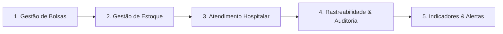

# Story Map — Entrega 2 (TDD) · Rota Vital

Este documento detalha o **User Story Mapping**, a quebra técnica das histórias selecionadas para a **Release 1 (Entrega E2)** do Desafio do PI (Infraestrutura de Software — 2026.2 | CESAR School) e a classificação transparente entre **TDD Estrito Demonstrado** e **Cobertura de Regressão**.

---

## 1. Backbone do Sistema (Jornada do Usuário)

O backbone representa a espinha dorsal das atividades essenciais para a operação do banco de sangue:

---

## 2. Release 1 — Escopo e Transparência de Testes

| ID | História de Usuário | Tipo de Desenvolvimento | Risco Mitigado |
|---|---|---|---|
| **US-01** | **Cadastro de Bolsa com Validações, Novo Hemocomponente (SANGUE_TOTAL) e Bloqueio de Duplicidade** | **TDD Estrito (Ciclo RED $\to$ GREEN):** Testes unitários e BDD escritos antes da implementação do suporte a `SANGUE_TOTAL` e da padronização de HTTP 400 para validade anterior à coleta. | **Alto:** Inconsistência cadastral ou tipo hemoterápico não aceito invalida a operação de triagem. |
| **US-02** | **Registro de Solicitação Hospitalar e Gestão de Fila FIFO** | **Cobertura de Regressão & Automação BDD:** Validação unitária de campos do DTO (`SolicitacaoValidationTest`) e teste da estrutura FIFO (`FilaRequisicoesTest`). | **Alto:** Inversão de prioridade em fila hospitalar põe pacientes receptores em risco. |
| **US-03** | **Histórico de Operações em Ordem LIFO (Pilha de Auditoria)** | **Cobertura de Regressão & Automação BDD:** Testes unitários da pilha LIFO (`PilhaHistoricoTest`), serviço (`HistoricoServiceTest`) e operação de pop do topo da auditoria. | **Médio:** Rastreabilidade cronológica reversa e auditoria clínica. |

> [!IMPORTANT]
> **Ressalva Arquitetural (US-03):** A operação de pop no histórico (`DELETE /api/historico/ultima`) atua desempilhando o registro de auditoria mais recente da pilha em memória. Ela **não** executa rollback automático dos dados transacionais gravados no banco de dados.

---

## 3. Quebra das Histórias em Tarefas Técnicas

### US-01: Cadastro de bolsa de hemocomponente
> **Como** operador do banco de sangue,  
> **Quero** cadastrar novas bolsas no estoque com tipos válidos (incluindo Sangue Total) e regras de consistência temporal,  
> **Para que** o estoque não contenha duplicidades nem bolsas inválidas.

#### Tarefas:
- **T1.1 (TDD - RED $\to$ GREEN):** Inclusão e validação do novo tipo `SANGUE_TOTAL` no enum `TipoComponente` e em `BolsaValidationTest`.
- **T1.2 (TDD - RED $\to$ GREEN):** Validação temporal: rejeição com HTTP 400 quando `dataValidade < dataColeta`.
- **T1.3 (Regressão / Regra):** Validação de volume positivo (`volume > 0`) e campos obrigatórios.
- **T1.4 (Regressão / Integração):** Teste de integração com banco/JPA validando constraint única de `codigoIdentificador` (`BolsaRepositoryIntegrationTest`).
- **T1.5 (BDD / Cucumber):** Automação dos cenários de aceitação em `docs/bdd/historia-1-cadastro-bolsa.feature`.

---

### US-02: Registro de solicitação hospitalar e fila FIFO
> **Como** hospital conveniado,  
> **Quero** submeter solicitações e ser atendido na ordem cronológica de chegada,  
> **Para que** o processamento seja justo e sem preempção indevida.

#### Tarefas:
- **T2.1 (Regressão / Unitário):** Validação de campos obrigatórios da solicitação hospitalar (`SolicitacaoValidationTest`).
- **T2.2 (Regressão / Estrutura):** Teste unitário da preservação de ordem na fila FIFO (`FilaRequisicoesTest`).
- **T2.3 (Regressão / Integração):** Atendimento e atualização de status no banco (`SolicitacaoSangueControllerTest`).
- **T2.4 (BDD / Cucumber):** Automação dos cenários de aceitação em `docs/bdd/historia-2-solicitacao-fila-fifo.feature`.

---

### US-03: Histórico de operações em ordem LIFO
> **Como** auditor do hemocentro,  
> **Quero** auditar a ordem cronológica reversa das ações e poder desempilhar a última movimentação registrada,  
> **Para que** intervenções incorretas no log de auditoria possam ser desfeitas.

#### Tarefas:
- **T3.1 (Regressão / Estrutura):** Teste unitário da pilha manual LIFO (`PilhaHistoricoTest`).
- **T3.2 (Regressão / Unitário):** Teste do serviço de histórico com consulta topo-primeiro e pop (`HistoricoServiceTest`).
- **T3.3 (Regressão / Integração):** Controller de histórico e persistência (`HistoricoControllerTest`).
- **T3.4 (BDD / Cucumber):** Automação dos cenários de aceitação em `docs/bdd/historia-3-historico-pilha-lifo.feature`.

---

## 4. Matriz de Rastreabilidade

| História | Tarefa | Nível | Classe / Arquivo de Teste |
|---|---|---|---|
| **US-01** | T1.1, T1.2, T1.3 | Unitário | `BolsaValidationTest.java` |
| **US-01** | T1.4 | Integração | `BolsaRepositoryIntegrationTest.java` / `BolsaControllerTest.java` |
| **US-01** | T1.5 | Aceitação (BDD) | `RunCucumberTest.java` $\to$ `historia-1-cadastro-bolsa.feature` |
| **US-02** | T2.1 | Unitário | `SolicitacaoValidationTest.java` |
| **US-02** | T2.2 | Estrutura | `FilaRequisicoesTest.java` |
| **US-02** | T2.3 | Integração | `SolicitacaoSangueControllerTest.java` |
| **US-02** | T2.4 | Aceitação (BDD) | `RunCucumberTest.java` $\to$ `historia-2-solicitacao-fila-fifo.feature` |
| **US-03** | T3.1 | Estrutura | `PilhaHistoricoTest.java` |
| **US-03** | T3.2 | Unitário | `HistoricoServiceTest.java` |
| **US-03** | T3.3 | Integração | `HistoricoControllerTest.java` |
| **US-03** | T3.4 | Aceitação (BDD) | `RunCucumberTest.java` $\to$ `historia-3-historico-pilha-lifo.feature` |
